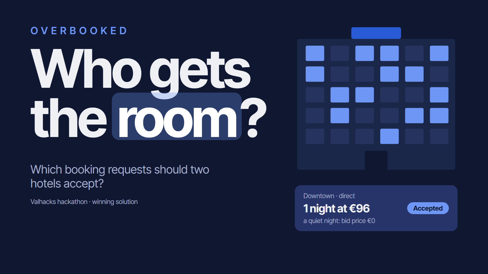
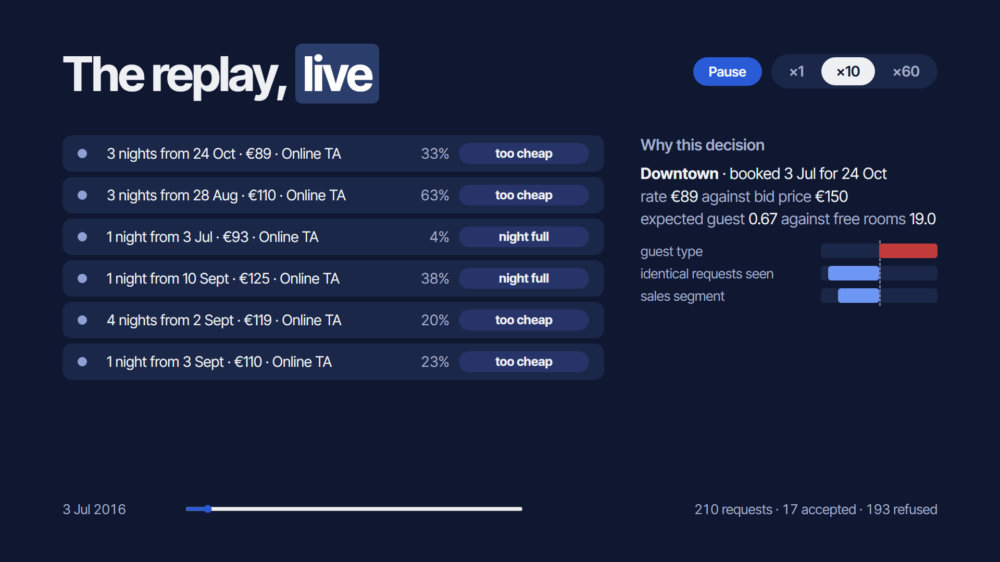
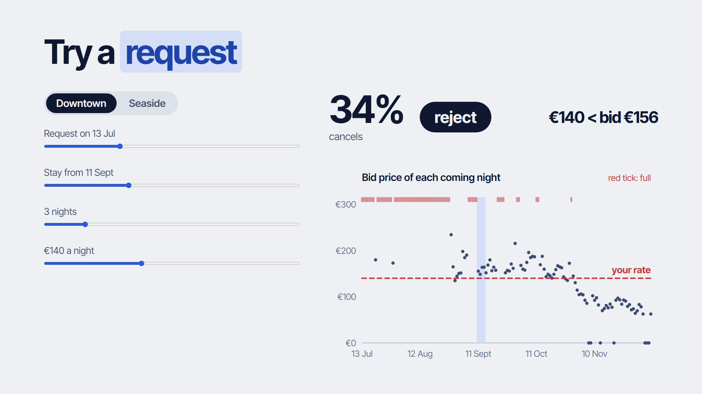
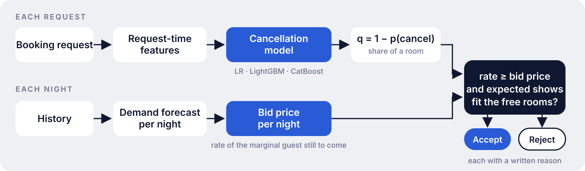

<div align="center">

# Overbooked

### Who gets the room?

**Winning solution of the Valhacks hackathon.**
Two hotels, one booking request at a time, and a decision that cannot be undone: accept or reject.

[](https://andrea0b.github.io/Valhacks-2026/)

<a href="https://andrea0b.github.io/Valhacks-2026/"></a>

<sub>33 slides · the real model runs in your browser · live replay of the policy · open it in any browser (arrow keys to move, `F` for full screen)</sub>

<br>

| **+29.4%** | **+20%** | **43%** | **2 ms** |
|:---:|:---:|:---:|:---:|
| net revenue over classic overbooking on the 2017 evaluator | over classic overbooking on the 2016 replay | of the gap to perfect foresight closed | per decision, each with a written reason |

</div>

---

## The idea in one minute

A third of the guests cancel, so a hotel that accepts only up to capacity leaves rooms empty. One that
accepts too many must send guests away at check-in and pay **2.5× the value of their stay**. The system
combines a **calibrated cancellation model** with an **economic bid-price rule**, and explains every
decision in plain language.

| | Net revenue, 2016 replay | vs. classic overbooking |
|---|---|---|
| No overbooking | 3.79 M€ | −28% |
| Classic overbooking (one cancellation rate per hotel) | 5.26 M€ | baseline |
| **This system** (stack of 3 models + bid prices) | **6.33 M€** | **+20%** |
| Oracle that knows who will show up (not achievable) | 7.76 M€ | +48% |

**2017 evaluation** (the organisers' evaluator, run on the frozen solution): **5,425,157 € net**,
**+29.4%** over classic overbooking (4,193,263 €) and **+72.3%** over no overbooking (3,149,034 €).
Details in [evaluation/](evaluation/README.md) and [notebook 10](notebooks/10_evaluator_2017.ipynb).

## Presentation

The whole story as one self-contained page: the task, the data, the model, the decision rule, the
results. Two slides run the real thing.

<table>
<tr>
<td width="50%"><a href="https://andrea0b.github.io/Valhacks-2026/"></a><br><b>The replay, live.</b> Six weeks of 2016 requests replayed through the policy, with the check that decided each one.</td>
<td width="50%"><a href="https://andrea0b.github.io/Valhacks-2026/"></a><br><b>Try a request.</b> Pick a stay and a rate: the model (a JavaScript port, parity-tested) scores it in the browser.</td>
</tr>
</table>

`docs/index.html` is a single self-contained file, served by GitHub Pages at the link above, or by any static server. Nothing to build to view it; the sources are in [`presentation/`](presentation/).

---

## The problem

* **Hotels.** Downtown (city hotel, 124 rooms, 41% of bookings cancelled) and Seaside (resort,
  103 rooms, 27% cancelled).
* **Decision.** Requests arrive in booking-date order; each must be accepted or rejected
  immediately, without seeing the future.
* **Payoff.** A guest who shows up pays `nightly_rate × nights`. If the hotel is full at check-in,
  the cheapest arriving guests are *walked*: no revenue and a penalty of 2.5 × their stay value.
* **Score.** Net revenue over a full year, computed by the organisers on a year we never saw.
  The model is trained once and stays frozen for the whole year.
* **Data.** 78,132 bookings with their outcome, arrivals July 2015 – December 2016
  (`train-template-kit/train.csv`). The `deposit` column is excluded by the organisers.
* **Second criterion.** Every decision must be explainable.

## How it works



1. **Cancellation model** (`src/stream_model.py`). A temporal stack of three different model
   families (logistic regression, LightGBM, CatBoost), trained with recency weights (half-life 6 months) on features a hotel actually knows
   when the request arrives. Calibration is what matters: the probability enters the money
   calculation directly.
2. **Bid-price policy** (`src/policy.py`). Every booking counts as `1 − p_cancel` rooms, which is
   where overbooking comes from. Every night has a *bid price*: the rate of the marginal guest we
   still expect to seat if we keep the room. A request is accepted when its nightly rate beats the
   average bid price of its stay and its expected shows fit the free rooms.
3. **Explanations** (`src/explain.py`). The stack's logit is decomposed *exactly* into
   per-input contributions (coefficients and TreeSHAP, weighted by the stack), and
   combined with the policy's numbers into one sentence per decision.

> *rejected: Downtown Hotel, 2 nights at 149 EUR: show-up probability 0.41, expected value 124 EUR;
> rate 149 EUR < reserve price 165 EUR (we still expect demand that pays more for these nights);
> main factors: guest type (more cancellation), sales segment (less cancellation), part of a group
> (more cancellation)*

## Analysis

Ten notebooks, one question each, executed with outputs. The full reasoning is in [docs/methodology.md](docs/methodology.md).

| Notebook | Question |
|---|---|
| [01 · Data overview](notebooks/01_data_overview.ipynb) | What is in the data, and what may be used? |
| [02 · Demand, capacity, price](notebooks/02_demand_capacity_pricing.ipynb) | Is capacity the constraint? |
| [03 · Cancellation drivers](notebooks/03_cancellation_drivers.ipynb) | Who cancels, and which signals can be trusted? |
| [04 · Customer segmentation](notebooks/04_customer_segmentation.ipynb) | Who are the customers? |
| [05 · Customer value and risk](notebooks/05_customer_value_and_risk.ipynb) | Who is worth the room? |
| [06 · Simulator and baselines](notebooks/06_simulator_and_baselines.ipynb) | How do we measure a policy? |
| [07 · Cancellation model](notebooks/07_cancellation_model.ipynb) | Which model, validated how? |
| [08 · Bid-price policy](notebooks/08_bid_price_policy.ipynb) | How is the decision made? |
| [09 · Explainability](notebooks/09_explainability.ipynb) | Why was this request accepted? |
| [10 · 2017 evaluation](notebooks/10_evaluator_2017.ipynb) | What did the organisers' evaluator say? |

## Design choices

* **Temporal validation only.** Three cuts fixed in advance (1 Jan, 1 Apr, 1 Jul 2016): train on arrivals before the cut, test on every later request. Random cross-validation overstates AUC by 0.14.
* **Request-time information only.** No fields that appear after the booking, no columns that drift over time, no `deposit`, no `booking_id` (it leaks the outcome).
* **Three model families, stacked.** Logistic regression, LightGBM and CatBoost, judged on calibration and log-loss because the probability feeds the money calculation directly.
* **Bid price per night.** A request is accepted when its rate beats the price of the marginal guest still expected for those nights and its expected shows fit the free rooms; on a quiet night the price is zero.

## Repository

```
├── solution.py                 the deliverable: Solution(commitments, capacity).decide(booking) / .explain()
├── src/
│   ├── features.py             request-time features + live stream counters (batch and online twins)
│   ├── stream_model.py         StreamCancelModel: LR / LightGBM / CatBoost, temporal stacking
│   ├── policy.py               ShowLoad, DemandForecast, BidPricePolicy
│   ├── explain.py              exact additive decomposition and the reason sentence
│   ├── simulator.py            local replay of the evaluation rules on a holdout window
│   ├── baselines.py            reference policies (no overbooking, classic overbooking, oracle)
│   ├── customers.py            segmentation helpers used by notebooks 04-05
│   ├── plotting.py             one colour system for every figure
│   └── build_final.py          retrains the final model on all the data
├── notebooks/                  01-10, one question each (executed, with outputs)
├── experiments/                scripts behind every table of notebooks 07-09, results in experiments/results/
├── evaluation/                 organisers' evaluator + 2017 test data, run.py, hashes of the solution, results
├── models/final.joblib         the shipped model (stack of three, trained on Jul 2015 - Dec 2016)
├── presentation/               sources of "Overbooked" (build.py writes docs/index.html)
├── docs/index.html             the presentation, built and self-contained
├── docs/methodology.md         decisions, in order, with the evidence for each
├── docs/figures/               figures written by the notebooks, plus the presentation previews
└── train-template-kit/         the organisers' data and template (unchanged)
```

## Reproduce

```bash
python -m venv .venv && .venv/Scripts/activate      # Windows; use bin/activate elsewhere
pip install -r requirements.txt
python -m src.build_final                          # retrains models/final.joblib (~5 min)
python experiments/01_walk_forward_metrics.py      # model metrics (notebook 07)
python experiments/05_decision_trace.py            # decision trace (notebooks 08-09)
python experiments/06_feature_importance.py        # global importance (notebook 09)
```

The revenue grids (`experiments/02_recipe_grid.py`, `03_finalists.py`, `04_policy_ablation.py`)
take about an hour each on a multi-core machine; their results are versioned in
`experiments/results/`. Using the deliverable:

```python
from solution import Solution
sol = Solution(commitments, capacity)        # once, before the year starts
accepted = sol.decide(booking)               # once per request, ~2 ms
print(sol.explain())                         # why
```

## Limits and next steps

* **One out-of-sample year.** All model and policy choices rest on the 2016 replay, and the 2017
  evaluation is a single draw; recipes within a few percent of each other are not distinguishable
  with this evidence.
* **The shipped stack is not the best offline recipe.** In hindsight the plain average of the same
  three models has better log-loss and calibration at every cut and is simpler; it would be the
  next default ([notebook 07](notebooks/07_cancellation_model.ipynb)).
* **Frozen for a year.** The demand forecast relies on last year's pattern plus a bounded growth
  factor; the cancellation model under-predicted cancellations by ~4 points at the July cut.
* **Selection bias.** Only accepted bookings are in the history; rejected demand is invisible.

Method, decisions and evidence in detail: [docs/methodology.md](docs/methodology.md).
